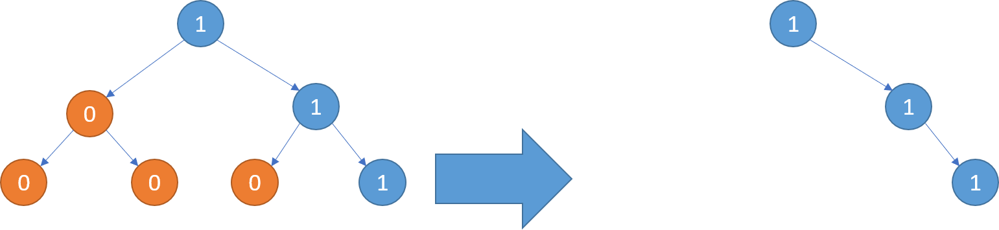

### [LCR 047. 二叉树剪枝](https://leetcode.cn/problems/pOCWxh/)

难度：中等

给定一个二叉树 **根节点** `root`，树的每个节点的值要么是 `0`，要么是 `1`。请剪除该二叉树中所有节点的值为 `0` 的子树。

节点 `node` 的子树为 `node` 本身，以及所有 `node` 的后代。

**示例 1：**

> **输入:** [1,null,0,0,1]
> **输出:** [1,null,0,null,1]
> **解释:**
> 只有红色节点满足条件“所有不包含 1 的子树”。
> 右图为返回的答案。
> 

**示例 2：**

> **输入:** [1,0,1,0,0,0,1]
> **输出:** [1,null,1,null,1]
> **解释:**
> 

**示例 3：**

> **输入:** [1,1,0,1,1,0,1,0]
> **输出:** [1,1,0,1,1,null,1]
> **解释:**
> 

**提示：**

- 二叉树的节点个数的范围是 `[1,200]`
- 二叉树节点的值只会是 `0` 或 `1`

**注意：** 本题与主站 814 题相同：[https://leetcode.cn/problems/binary-tree-pruning/](https://leetcode.cn/problems/binary-tree-pruning/)
