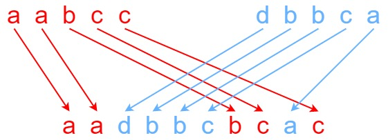

### [LCR 096. 交错字符串](https://leetcode.cn/problems/IY6buf/)

难度：中等

给定三个字符串 `s1`、`s2`、`s3`，请判断 `s3` 能不能由 `s1` 和 `s2` **交织（交错）** 组成。

两个字符串 `s` 和 `t` **交织** 的定义与过程如下，其中每个字符串都会被分割成若干 **非空** 子字符串：

- <code>s = s1 + s2 + ... + sn</code>
- <code>t = t1 + t2 + ... + tm</code>
- `|n - m| <= 1`
- **交织** 是 <code>s1 + t1 + s2 + t2 + s3 + t3 + ...</code> 或者 <code>t1 + s1 + t2 + s2 + t3 + s3 + ...</code>

**提示：**`a + b` 意味着字符串 `a` 和 `b` 连接。

**示例 1：**

> 
> **输入：** s1 = "aabcc", s2 = "dbbca", s3 = "aadbbcbcac"
> **输出：** true

**示例 2：**

> **输入：** s1 = "aabcc", s2 = "dbbca", s3 = "aadbbbaccc"
> **输出：** false

**示例 3：**

> **输入：** s1 = "", s2 = "", s3 = ""
> **输出：** true

**提示：**

- `0 <= s1.length, s2.length <= 100`
- `0 <= s3.length <= 200`
- `s1`、`s2`、和 `s3` 都由小写英文字母组成

**注意：** 本题与主站 97 题相同：[https://leetcode.cn/problems/interleaving-string/](https://leetcode.cn/problems/interleaving-string/)
