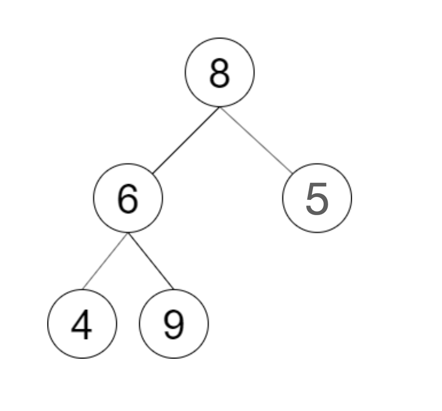
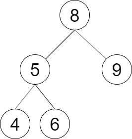

### [LCR 152. 验证二叉搜索树的后序遍历序列](https://leetcode.cn/problems/er-cha-sou-suo-shu-de-hou-xu-bian-li-xu-lie-lcof/)

难度：中等

请实现一个函数来判断整数数组 `postorder` 是否为二叉搜索树的后序遍历结果。

**示例 1：**

> 
> **输入：** postorder = [4,9,6,5,8]
> **输出：** false
> **解释：** 从上图可以看出这不是一颗二叉搜索树

**示例 2：**

> 
> **输入：** postorder = [4,6,5,9,8]
> **输出：** true
> **解释：** 可构建的二叉搜索树如上图

**提示：**

- `数组长度 <= 1000`
- `postorder` 中无重复数字
