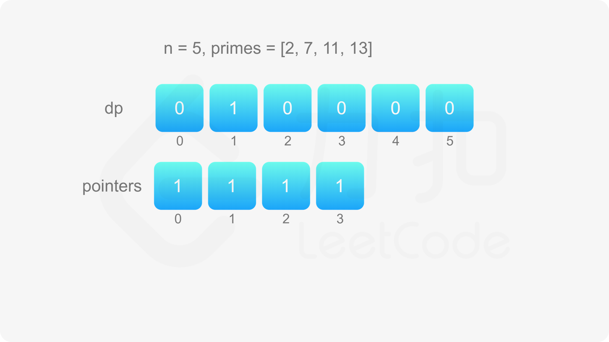
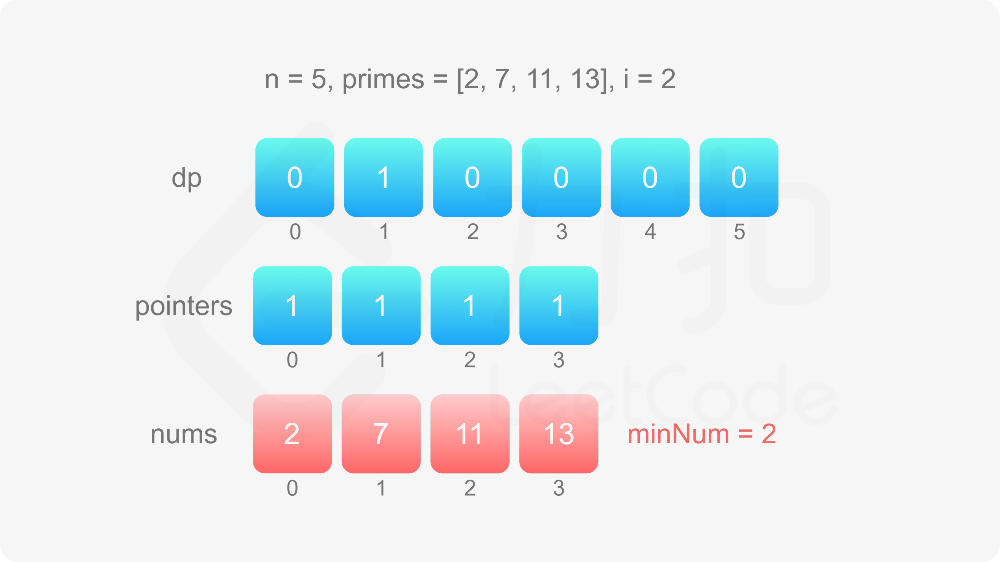
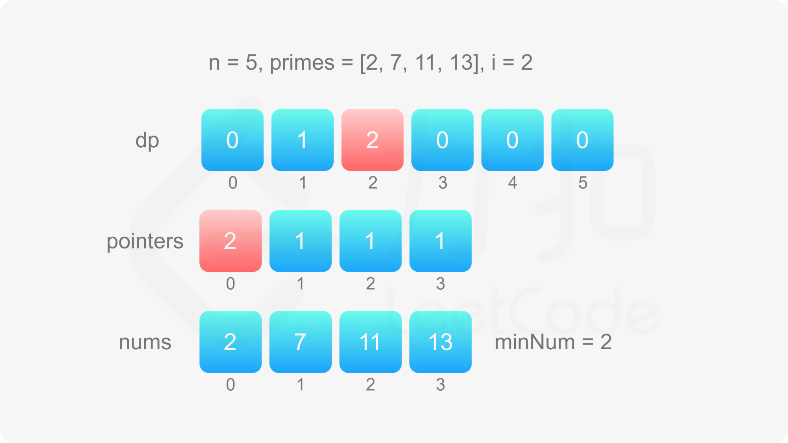
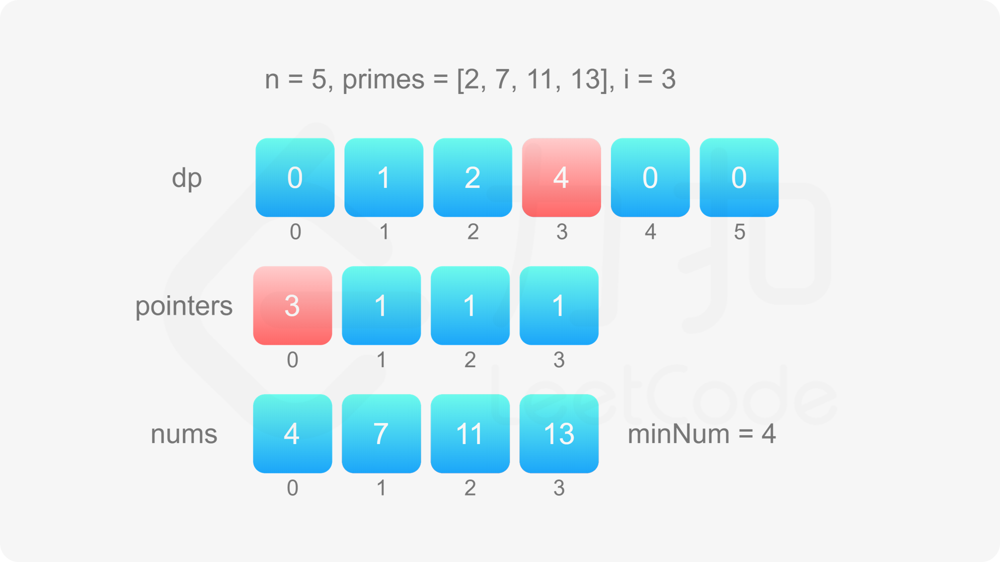
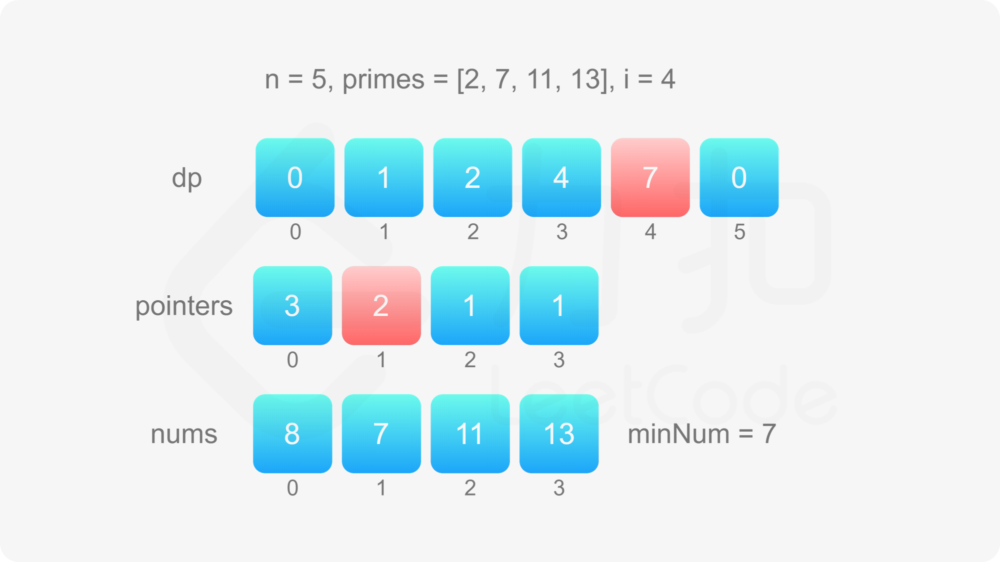
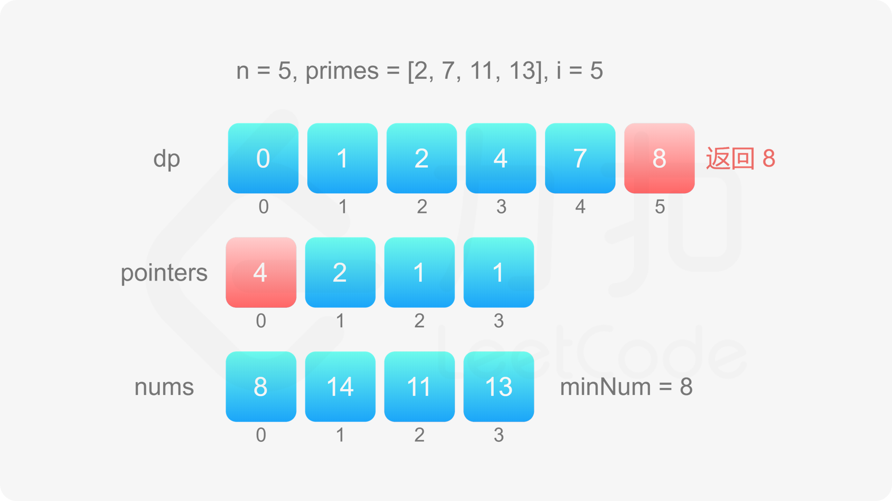

### [超级丑数](https://leetcode.cn/problems/super-ugly-number/solutions/924207/chao-ji-chou-shu-by-leetcode-solution-uzff/?envType=problem-list-v2&envId=ySsxoJfz)

#### 前言

这道题和「[264\. 丑数 II](https://leetcode.cn/problems/ugly-number-ii)」相似，区别在于，第 $264$ 题规定丑数是只包含质因数 2、3 和 $5$ 的正整数，这道题规定超级丑数是只包含数组 $primes$ 中的质因数的正整数。

第 $264$ 题的方法包括最小堆和动态规划。由于这道题的数据规模较大，因此最小堆的解法会超时，此处只提供动态规划的解法。

#### 方法一：动态规划

定义数组 $dp$，其中 $dp[i]$ 表示第 $i$ 个超级丑数，第 $n$ 个超级丑数即为 $dp[n]$。

由于最小的超级丑数是 $1$，因此 $dp[1]=1$。

如何得到其余的超级丑数呢？创建与数组 $primes$ 相同长度的数组 $pointers$，表示下一个超级丑数是当前指针指向的超级丑数乘以对应的质因数。初始时，数组 $pointers$ 的元素值都是 $1$。

当 $2\le i\le n$ 时，令 $dp[i]=\mathop{min}\limits_{0\le j<m}{dp[pointers[j]]\times primes[j]}$，然后对于每个 $0\le j<m$，分别比较 $dp[i]$ 和 $dp[pointers[j]]\times primes[j]$ 是否相等，如果相等则将 $pointers[j]$ 加 $1$。

**正确性证明**

对于 $i>1$，在计算 $dp[i]$ 时，指针 $pointers[j](0\le j<m)$ 的含义是使得 $dp[k]\times primes[j]>dp[i-1]$ 的最小的下标 $k$，即当 $k\ge pointers[j]$ 时 $dp[k]\times primes[j]>dp[i-1]$，当 $k<pointers[j]$ 时 $dp[k]\times primes[j]\le dp[i-1]$。

因此，对于 $i>1$，在计算 $dp[i]$ 时，对任意 $0\le j<m$，dp[pointers[j]]\times $primes[j]$ 都大于 $dp[i-1]$，dp[pointers[j]-1]\times $primes[j]$ 都小于或等于 $dp[i-1]$。令 $dp[i]=\mathop{min}\limits_{0\le j<m}{dp[pointers[j]]\times primes[j]}$，则 $dp[i]>dp[i-1]$ 且 $dp[i]$ 是大于 $dp[i-1]$ 的最小的超级丑数。

在计算 $dp[i]$ 之后，会更新数组 $pointers$ 中的指针，更新之后的指针将用于计算 $dp[i+1]$，同样满足 $dp[i+1]>dp[i]$ 且 $dp[i+1]$ 是大于 $dp[i]$ 的最小的超级丑数。











```Java
class Solution {
    public int nthSuperUglyNumber(int n, int[] primes) {
        int[] dp = new int[n + 1];
        int m = primes.length;
        int[] pointers = new int[m];
        int[] nums = new int[m];
        Arrays.fill(nums, 1);
        for (int i = 1; i <= n; i++) {
            int minNum = Arrays.stream(nums).min().getAsInt();
            dp[i] = minNum;
            for (int j = 0; j < m; j++) {
                if (nums[j] == minNum) {
                    pointers[j]++;
                    nums[j] = dp[pointers[j]] * primes[j];
                }
            }
        }
        return dp[n];
    }
}
```

```CSharp
public class Solution {
    public int NthSuperUglyNumber(int n, int[] primes) {
        int[] dp = new int[n + 1];
        int m = primes.Length;
        int[] pointers = new int[m];
        int[] nums = new int[m];
        Array.Fill(nums, 1);
        for (int i = 1; i <= n; i++) {
            int minNum = nums.Min();
            dp[i] = minNum;
            for (int j = 0; j < m; j++) {
                if (nums[j] == minNum) {
                    pointers[j]++;
                    nums[j] = dp[pointers[j]] * primes[j];
                }
            }
        }
        return dp[n];
    }
}
```

```JavaScript
var nthSuperUglyNumber = function(n, primes) {
    const dp = new Array(n + 1).fill(0);
    const m = primes.length;
    const pointers = new Array(m).fill(0);
    const nums = new Array(m).fill(1);
    for (let i = 1; i <= n; i++) {
        let minNum = Number.MAX_SAFE_INTEGER;
        for (let j = 0; j < m; j++) {
            minNum = Math.min(minNum, nums[j]);
        }
        dp[i] = minNum;
        for (let j = 0; j < m; j++) {
            if (nums[j] == minNum) {
                pointers[j]++;
                nums[j] = dp[pointers[j]] * primes[j];
            }
        }
    }
    return dp[n];
};
```

```Python
class Solution:
    def nthSuperUglyNumber(self, n: int, primes: List[int]) -> int:
        dp = [0] * (n + 1)
        m = len(primes)
        pointers = [0] * m
        nums = [1] * m

        for i in range(1, n + 1):
            min_num = min(nums)
            dp[i] = min_num
            for j in range(m):
                if nums[j] == min_num:
                    pointers[j] += 1
                    nums[j] = dp[pointers[j]] * primes[j]

        return dp[n]
```

```C++
class Solution {
public:
    int nthSuperUglyNumber(int n, vector<int>& primes) {
        vector<long> dp(n + 1);
        int m = primes.size();
        vector<int> pointers(m, 0);
        vector<long> nums(m, 1);
        for (int i = 1; i <= n; i++) {
            long minNum = INT_MAX;
            for (int j = 0; j < m; j++) {
                minNum = min(minNum, nums[j]);
            }
            dp[i] = minNum;
            for (int j = 0; j < m; j++) {
                if (nums[j] == minNum) {
                    pointers[j]++;
                    nums[j] = dp[pointers[j]] * primes[j];
                }
            }
        }
        return dp[n];
    }
};
```

```C
int nthSuperUglyNumber(int n, int* primes, int primesSize) {
    long dp[n + 1];
    int pointers[primesSize];
    for (int i = 0; i < primesSize; i++) {
        pointers[i] = 0;
    }
    long nums[primesSize];
    for (int i = 0; i < primesSize; i++) {
        nums[i] = 1;
    }
    for (int i = 1; i <= n; i++) {
        long minNum = INT_MAX;
        for (int j = 0; j < primesSize; j++) {
            minNum = fmin(minNum, nums[j]);
        }
        dp[i] = minNum;
        for (int j = 0; j < primesSize; j++) {
            if (nums[j] == minNum) {
                pointers[j]++;
                nums[j] = dp[pointers[j]] * primes[j];
            }
        }
    }
    return dp[n];
}
```

```Go
func nthSuperUglyNumber(n int, primes []int) int {
    dp := make([]int, n+1)
    m := len(primes)
    pointers := make([]int, m)
    nums := make([]int, m)
    for i := range nums {
        nums[i] = 1
    }
    for i := 1; i <= n; i++ {
        minNum := math.MaxInt64
        for j := range pointers {
            minNum = min(minNum, nums[j])
        }
        dp[i] = minNum
        for j := range nums {
            if nums[j] == minNum {
                pointers[j]++
                nums[j] = dp[pointers[j]] * primes[j]
            }
        }
    }
    return dp[n]
}

func min(a, b int) int {
    if a < b {
        return a
    }
    return b
}
```

**复杂度分析**

- 时间复杂度：$O(nm)$，其中 $n$ 是待求的超级丑数的编号，$m$ 是数组 $primes$ 的长度。需要计算数组 $dp$ 中的 $n$ 个元素，每个元素的计算都需要 $O(m)$ 的时间。
- 空间复杂度：$O(n+m)$，其中 $n$ 是待求的超级丑数的编号，$m$ 是数组 $primes$ 的长度。需要创建数组 dp、数组 $pointers$ 和数组 $nums$，空间分别是 O(n)、O(m)和O(m)$。
