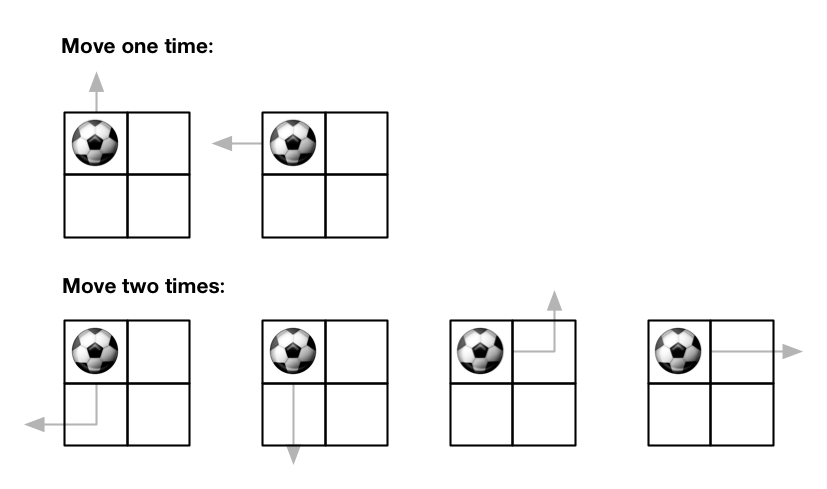
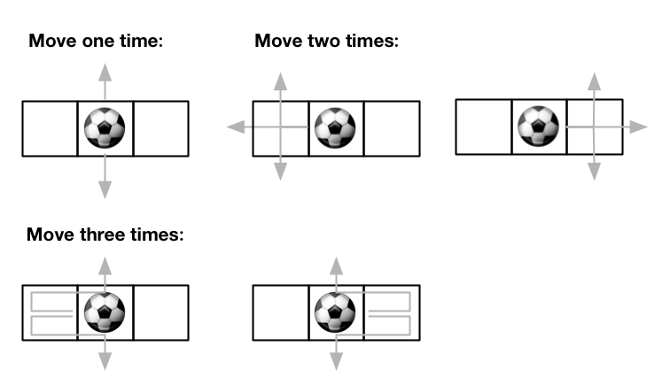

### [576\. 出界的路径数](https://leetcode.cn/problems/out-of-boundary-paths/)

难度：中等

给你一个大小为 <code>m &times; n</code> 的网格和一个球。球的起始坐标为 `[startRow, startColumn]`。你可以将球移到在四个方向上相邻的单元格内（可以穿过网格边界到达网格之外）。你 **最多** 可以移动 `maxMove` 次球。

给你五个整数 `m`、`n`、`maxMove`、`startRow` 以及 `startColumn`，找出并返回可以将球移出边界的路径数量。因为答案可能非常大，返回对 <code>109 + 7</code> **取余** 后的结果。

**示例 1：**

> 
> **输入：** m = 2, n = 2, maxMove = 2, startRow = 0, startColumn = 0
> **输出：** 6

**示例 2：**

> 
> **输入：** m = 1, n = 3, maxMove = 3, startRow = 0, startColumn = 1
> **输出：** 12

**提示：**

- `1 <= m, n <= 50`
- `0 <= maxMove <= 50`
- `0 <= startRow < m`
- `0 <= startColumn < n`
