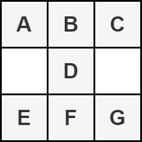
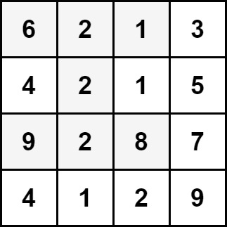

### [2428\. 沙漏的最大总和](https://leetcode.cn/problems/maximum-sum-of-an-hourglass/)

难度：中等

给你一个大小为 <code>m &times; n</code> 的整数矩阵 `grid`。

按以下形式将矩阵的一部分定义为一个 **沙漏**：

返回沙漏中元素的 **最大** 总和。

**注意：** 沙漏无法旋转且必须整个包含在矩阵中。

**示例 1：**

> 
> **输入：** grid = \[[6,2,1,3],[4,2,1,5],[9,2,8,7],[4,1,2,9]]
> **输出：** 30
> **解释：** 上图中的单元格表示元素总和最大的沙漏：6 + 2 + 1 + 2 + 9 + 2 + 8 = 30。

**示例 2：**

> 
> **输入：** grid = \[[1,2,3],[4,5,6],[7,8,9]]
> **输出：** 35
> **解释：** 上图中的单元格表示元素总和最大的沙漏：1 + 2 + 3 + 5 + 7 + 8 + 9 = 35。

**提示：**

- `m == grid.length`
- `n == grid[i].length`
- `3 <= m, n <= 150`
- <code>0 <= grid[i][j] <= 106</code>
