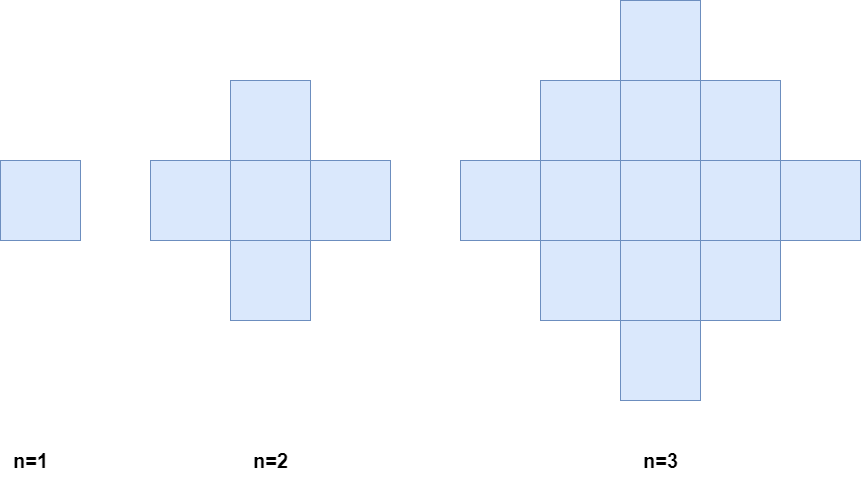

### [2579\. 统计染色格子数](https://leetcode.cn/problems/count-total-number-of-colored-cells/)

难度：中等

有一个无穷大的二维网格图，一开始所有格子都未染色。给你一个正整数 `n`，表示你需要执行以下步骤 `n` 分钟：

- 第一分钟，将 **任一** 格子染成蓝色。
- 之后的每一分钟，将与蓝色格子相邻的 **所有** 未染色格子染成蓝色。

下图分别是 1、2、3 分钟后的网格图。

请你返回 `n` 分钟之后 **被染色的格子** 数目。

**示例 1：**

> **输入：** n = 1
> **输出：** 1
> **解释：** 1 分钟后，只有 1 个蓝色的格子，所以返回 1。

**示例 2：**

> **输入：** n = 2
> **输出：** 5
> **解释：** 2 分钟后，有 4 个在边缘的蓝色格子和 1 个在中间的蓝色格子，所以返回 5。

**提示：**

- <code>1 <= n <= 105</code>
