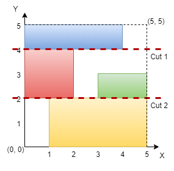

### [3394\. 判断网格图能否被切割成块](https://leetcode.cn/problems/check-if-grid-can-be-cut-into-sections/)

难度：中等

给你一个整数 `n` 表示一个 <code>n &times; n</code> 的网格图，坐标原点是这个网格图的左下角。同时给你一个二维坐标数组 `rectangles`，其中 `rectangles[i]` 的格式为 <code>[startx, starty, endx, endy]</code>，表示网格图中的一个矩形。每个矩形定义如下：

- <code>(startx, starty)</code>：矩形的左下角。
- <code>(endx, endy)</code>：矩形的右上角。

**注意**，矩形相互之间不会重叠。你的任务是判断是否能找到两条 **要么都垂直要么都水平** 的 **两条切割线**，满足：

- 切割得到的三个部分分别都 **至少** 包含一个矩形。
- 每个矩形都 **恰好仅** 属于一个切割得到的部分。

如果可以得到这样的切割，请你返回 `true`，否则返回 `false`。

**示例 1：**

> **输入：** n = 5, rectangles = \[[1,0,5,2],[0,2,2,4],[3,2,5,3],[0,4,4,5]]
> **输出：** true
> **解释：**
> 
> 网格图如上所示，我们可以在 `y = 2` 和 `y = 4` 处进行水平切割，所以返回 true。

**示例 2：**

> **输入：** n = 4, rectangles = \[[0,0,1,1],[2,0,3,4],[0,2,2,3],[3,0,4,3]]
> **输出：** true
> **解释：**
> ![](./assets/img/Question3394_02.png
> 我们可以在 `x = 2` 和 `x = 3` 处进行竖直切割，所以返回 true。

**示例 3：**

> **输入：** n = 4, rectangles = \[[0,2,2,4],[1,0,3,2],[2,2,3,4],[3,0,4,2],[3,2,4,4]]
> **输出：** false
> **解释：**
> 我们无法进行任何两条水平或者两条竖直切割并且满足题目要求，所以返回 false。

**提示：**

- <code>3 <= n <= 109</code>
- <code>3 <= rectangles.length <= 105</code>
- `0 <= rectangles[i][0] < rectangles[i][2] <= n`
- `0 <= rectangles[i][1] < rectangles[i][3] <= n`
- 矩形之间两两不会有重叠。
