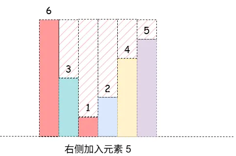
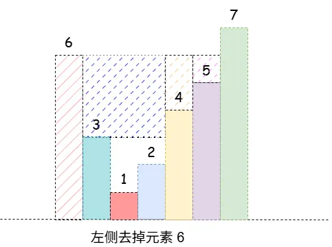

### [统计 K 次操作以内得到非递减子数组的数目](https://leetcode.cn/problems/count-non-decreasing-subarrays-after-k-operations/solutions/4053152/tong-ji-k-ci-cao-zuo-yi-nei-de-dao-fei-d-m9xd/)

#### 方法一：滑动窗口

**思路与算法**

每次操作可以将子数组中的任意一个元素增加 $1$。题目要求返回在至多 $k$ 次操作以内，能够变成**非递减**的子数组数目。

**第一步：先解决一个子问题——单个数组的最少操作次数**

给定一个数组 $arr$，把它整体变成**非递减**最少需要多少次操作？参考 $\lceil$[3402\. 使每一列严格递增的最少操作次数](https://leetcode.cn/problems/minimum-operations-to-make-columns-strictly-increasing/description/)$\rfloor$ 的贪心思路，从左到右依次处理每个元素 $arr_i$：

- 如果 $arr_i$ 大于等于前一个元素 $arr_{i-1}$，那么它保持不动；
- 如果 $arr_i$ 小于前一个元素 $arr_{i-1}$，为了让数组非递减，$arr_i$ 至少要增大到 $arr_{i-1}$；而恰好增大到 $arr_{i-1}$ 是最优的（再大只会让后面的元素付出更多代价），此时需要 $arr_{i-1}-arr_i$ 次操作。

这里的“前一个元素”指的是**调整之后**的取值。由于操作只增不减，它实际上就是当前位置的**前缀最大值**。

**第二步：用滑动窗口枚举所有子数组**

我们最直接的做法是枚举所有连续子数组、逐个计算代价，但这样显然太慢，需要进一步优化。我们可以观察到：如果一个数组 $arr$ 能在至多 $k$ 次操作内变为非递减，那么它的**任意子数组**也一定可以——因为非递减数组的子数组仍然非递减，只不过是把同样的调整放在更短的区间上做而已。换句话说，当固定右端点时，代价随着左端点右移而单调不增，因此可以用双指针来计数。

因此我们可以从小到大枚举右端点 $right$，同时维护左端点 $left$ 能取到的最右位置，也就是让窗口 $[left,right]$ 变为非递减所需最少操作次数不超过 $k$ 的最大 $left$。此时以 $right$ 结尾且满足要求的子数组恰好有 $right-left+1$ 个，把它们全部累加即为答案。

**第三步：窗口滑动时如何维护“最少操作次数”**

窗口每次只会发生两种变化：在右端加入一个元素，或者在左端去掉一个元素。我们分别分析这两种情况下，讨论最少操作次数该如何变化。

- **在窗口右侧末尾加入一个元素 x**：记加入前窗口内的最大元素为 $maxVal$。由于 $x$ 是窗口的最后一个元素，如果要保持**非递减**，此时它至少要增大到 $maxVal$，所以最少操作次数要增加 $max(0,maxVal-x)$。窗口最大值可以用优先队列或者单调队列维护，可以参考 $\lceil$[239\. 滑动窗口最大值](https://leetcode.cn/problems/sliding-window-maximum/)$\rfloor$。
    
- **在窗口左侧起始去掉一个元素 x**：这一种情况要麻烦一些，因为 $x$ 被移除后，它原先“撑起”的那部分代价也要一并扣掉。先看 $x$ 会影响哪些元素：大于等于 $x$ 的元素显然不受影响，只有比 $x$ 小的元素才可能受影响。设 $x$ 的下标为 $i$，x 右侧第一个大于等于 $x$ 的元素下标为 $j$，那么我们只需要考虑落在 $[i+1,j-1]$ 内的元素。$ $
    
  - 先用一个例子建立直觉：假设窗口内的数是 $[6,3,1,2,4,5,7]$，开头的 $6$ 把后面所有比它小的元素都“**覆盖**”了。如果把开头的 $6$ 去掉，这些被它覆盖的元素就会“**重见天日**”。究竟是哪些？是那些**左边最近的更大元素恰好为 6** 的元素，也就是值为 $(3,4,5)$ 的三个元素；而值为 $(1,2)$ 的两个元素仍然被 $3$ 覆盖着，不受影响。原因很直观：只要一个元素的左边还存在更大的元素，它就必须被抬升到那个元素的高度，而 $(1,2)$ 左边的 $3$ 并没有被移除，所以它们仍然被 $3$ **覆盖**。
  - 接着看这些贡献该怎么扣除：设下标 $k$ 的元素被 $x$ 覆盖（即 $k$ 左边最近的更大元素正好是 $x$ 所在的下标）。把 $arrk$ 抬升到 $x$ 需要 $x-arrk$ 次操作，去掉 $x$ 后这部分代价就要被扣除；继续往后看，只要后面的元素仍然小于 $arrk$，它们的抬升目标也会同样从 $x$ 降到 $arrk$，每个位置都少算 $x-arrk$，直到遇到第一个大于等于 $arrk$ 的元素为止。也就是说，从 $k$ 开始、到 $k$ 右侧第一个大于等于 $arrk$ 的元素之前为止，这一段可以整体扣除 $(j^′-k)\times (x-arrk)$ 次操作，其中 $j^′$ 是 $k$ 右侧第一个大于等于 $arrk$ 的元素下标；如果 $j^′$ 已经越过窗口右端点，则截断到右端点即可。
  - 而“某个元素右侧第一个大于等于它的元素”，正是经典的**下一个更大元素**，可以用单调栈求出，参考 $\lceil$[496\. 下一个更大元素 I](https://leetcode.cn/problems/next-greater-element-i/description/)$\rfloor$。把被 $x$ 覆盖的所有下标对应的扣除量累加，就得到移除 $x$ 后最少操作次数应减少的总量。

**总结**：依次枚举右端点 $right$，用双指针维护左端点 $left$，使窗口 $[left,right]$ 变为非递减所需的最少操作次数不超过 $k$。加入元素时，用优先队列维护窗口最大值，从而得到代价增量；移除元素时，用单调栈预处理出的信息扣掉被移除元素的贡献。以下标 $right$ 结尾的合法子数组有 $right-left+1$ 个，累加即为答案。

**代码**

```C++
class Solution {
public:
    long long countNonDecreasingSubarrays(vector<int>& nums, int k) {
        int n = nums.size();
        long long ans = 0;
        int operations = 0;
        // 优先队列维护窗口最大值
        priority_queue<pair<int, int>> q;
        // 记录被该下标覆盖的元素集合
        vector<vector<int>> cnt(n);
        // 右侧第一个大于等于的下标
        vector<int> pos(n, n);
        // 递减单调栈
        stack<int> st;

        for (int left = 0, right = 0; right < n; right++) {
            // 维护单调栈
            while (!st.empty() && nums[right] >= nums[st.top()]) {
                pos[st.top()] = right;
                st.pop();
            }
            // 栈顶即为 nums[right] 的左边最近的更大元素
            if (!st.empty()) {
                cnt[st.top()].push_back(right);
            }
            st.push(right);

            // 优先队列队首元素即为窗口最大值
            q.emplace(nums[right], right);
            // 窗口加入 nums[right] 操作次数需要增加
            operations += max(0, q.top().first - nums[right]);

            // 最小操作次数超过 k，此时需要缩小窗口
            while (operations > k) {
                // 移除窗口左侧元素 nums[left]，操作次数需要较少
                for (int i : cnt[left]) {
                    // 移除贡献
                    operations -= (nums[left] - nums[i]) * (min(pos[i], right + 1) - i);
                }
                left++;
            }

            // 从优先队列中移除小于下标 left 的元素
            while (!q.empty() && q.top().second < left) {
                q.pop();
            }

            // 以 right 为结尾的合法连续子数组数目为 right - left + 1
            ans += right - left + 1;
        }

        return ans;
    }
};
```

```Java
class Solution {
    public long countNonDecreasingSubarrays(int[] nums, int k) {
        int n = nums.length;
        long ans = 0;
        long operations = 0;
        // 优先队列维护窗口最大值
        PriorityQueue<int[]> q = new PriorityQueue<>((a, b) -> b[0] - a[0]);
        // 记录被该下标覆盖的元素集合
        List<List<Integer>> cnt = new ArrayList<>();
        for (int i = 0; i < n; i++) {
            cnt.add(new ArrayList<>());
        }
        // 右侧第一个大于等于的下标
        int[] pos = new int[n];
        Arrays.fill(pos, n);
        // 递减单调栈
        Deque<Integer> st = new ArrayDeque<>();

        for (int left = 0, right = 0; right < n; right++) {
            // 维护单调栈
            while (!st.isEmpty() && nums[right] >= nums[st.peek()]) {
                pos[st.peek()] = right;
                st.pop();
            }
            // 栈顶即为 nums[right] 的左边最近的更大元素
            if (!st.isEmpty()) {
                cnt.get(st.peek()).add(right);
            }
            st.push(right);

            // 优先队首元素即为窗口最大值
            q.offer(new int[]{nums[right], right});
            // 窗口加入 nums[right] 操作次数需要增加
            operations += Math.max(0, q.peek()[0] - nums[right]);

            // 最小操作次数超过 k，此时需要缩小窗口
            while (operations > k) {
                // 移除窗口左侧元素 nums[left]，操作次数需要较少
                for (int i : cnt.get(left)) {
                    // 移除贡献
                    operations -= (long) (nums[left] - nums[i]) * (Math.min(pos[i], right + 1) - i);
                }
                left++;
            }

            // 从优先队列中移除小于下标 left 的元素
            while (!q.isEmpty() && q.peek()[1] < left) {
                q.poll();
            }

            // 以 right 为结尾的合法连续子数组数目为 right - left + 1
            ans += right - left + 1;
        }

        return ans;
    }
}
```

```CSharp
public class Solution {
    public long CountNonDecreasingSubarrays(int[] nums, int k) {
        int n = nums.Length;
        long ans = 0;
        long operations = 0;
        // 优先队列维护窗口最大值
        var q = new PriorityQueue<(int val, int idx), int>();
        // 记录被该下标覆盖的元素集合
        var cnt = new List<int>[n];
        for (int i = 0; i < n; i++) {
            cnt[i] = new List<int>();
        }
        // 右侧第一个大于等于的下标
        var pos = new int[n];
        Array.Fill(pos, n);
        // 递减单调栈
        var st = new Stack<int>();

        for (int left = 0, right = 0; right < n; right++) {
            // 维护单调栈
            while (st.Count > 0 && nums[right] >= nums[st.Peek()]) {
                pos[st.Peek()] = right;
                st.Pop();
            }
            // 栈顶即为 nums[right] 的左边最近的更大元素
            if (st.Count > 0) {
                cnt[st.Peek()].Add(right);
            }
            st.Push(right);

            // 优先队首元素即为窗口最大值
            q.Enqueue((nums[right], right), -nums[right]);
            // 窗口加入 nums[right] 操作次数需要增加
            operations += Math.Max(0, q.Peek().val - nums[right]);

            // 最小操作次数超过 k，此时需要缩小窗口
            while (operations > k) {
                // 移除窗口左侧元素 nums[left]，操作次数需要较少
                foreach (int i in cnt[left]) {
                    // 移除贡献
                    operations -= (long)(nums[left] - nums[i]) * (Math.Min(pos[i], right + 1) - i);
                }
                left++;
            }

            // 从优先队列中移除小于下标 left 的元素
            while (q.Count > 0 && q.Peek().idx < left) {
                q.Dequeue();
            }

            // 以 right 为结尾的合法连续子数组数目为 right - left + 1
            ans += right - left + 1;
        }

        return ans;
    }
}
```

```Go
func countNonDecreasingSubarrays(nums []int, k int) int64 {
    n := len(nums)
    var ans int64 = 0
    var operations int64 = 0
    // 优先队列维护窗口最大值
    h := &MaxHeap{}
    heap.Init(h)
    // 记录被该下标覆盖的元素集合
    cnt := make([][]int, n)
    for i := range cnt {
        cnt[i] = []int{}
    }
    // 右侧第一个大于等于的下标
    pos := make([]int, n)
    for i := range pos {
        pos[i] = n
    }
    // 递减单调栈
    st := []int{}

    left := 0
    for right := 0; right < n; right++ {
        // 维护单调栈
        for len(st) > 0 && nums[right] >= nums[st[len(st)-1]] {
            pos[st[len(st)-1]] = right
            st = st[:len(st)-1]
        }
        // 栈顶即为 nums[right] 的左边最近的更大元素
        if len(st) > 0 {
            cnt[st[len(st)-1]] = append(cnt[st[len(st)-1]], right)
        }
        st = append(st, right)

        // 优先队首元素即为窗口最大值
        heap.Push(h, [2]int{nums[right], right})
        // 窗口加入 nums[right] 操作次数需要增加
        if diff := (*h)[0][0] - nums[right]; diff > 0 {
            operations += int64(diff)
        }

        // 最小操作次数超过 k，此时需要缩小窗口
        for operations > int64(k) {
            // 移除窗口左侧元素 nums[left]，操作次数需要较少
            for _, i := range cnt[left] {
                // 移除贡献
                operations -= int64(nums[left]-nums[i]) * int64(min(pos[i], right+1)-i)
            }
            left++
        }

        // 从优先队列中移除小于下标 left 的元素
        for h.Len() > 0 && (*h)[0][1] < left {
            heap.Pop(h)
        }

        // 以 right 为结尾的合法连续子数组数目为 right - left + 1
        ans += int64(right - left + 1)
    }

    return ans
}

type MaxHeap [][2]int

func (h MaxHeap) Len() int            { return len(h) }
func (h MaxHeap) Less(i, j int) bool  { return h[i][0] > h[j][0] }
func (h MaxHeap) Swap(i, j int)       { h[i], h[j] = h[j], h[i] }
func (h *MaxHeap) Push(x interface{}) { *h = append(*h, x.([2]int)) }
func (h *MaxHeap) Pop() interface{} {
    old := *h
    n := len(old)
    x := old[n-1]
    *h = old[:n-1]
    return x
}

func min(a, b int) int {
    if a < b {
        return a
    }
    return b
}
```

```Python
class Solution:
    def countNonDecreasingSubarrays(self, nums: List[int], k: int) -> int:
        n = len(nums)
        ans = 0
        operations = 0
        # 优先队列维护窗口最大值
        q = []
        # 记录被该下标覆盖的元素集合
        cnt = [[] for _ in range(n)]
        # 右侧第一个大于等于的下标
        pos = [n] * n
        # 递减单调栈
        st = []

        left = 0
        for right in range(n):
            # 维护单调栈
            while st and nums[right] >= nums[st[-1]]:
                pos[st[-1]] = right
                st.pop()
            # 栈顶即为 nums[right] 的左边最近的更大元素
            if st:
                cnt[st[-1]].append(right)
            st.append(right)

            # 优先队首元素即为窗口最大值
            heapq.heappush(q, (-nums[right], right))
            # 窗口加入 nums[right] 操作次数需要增加
            operations += max(0, -q[0][0] - nums[right])

            # 最小操作次数超过 k，此时需要缩小窗口
            while operations > k:
                # 移除窗口左侧元素 nums[left]，操作次数需要较少
                for i in cnt[left]:
                    # 移除贡献
                    operations -= (nums[left] - nums[i]) * (min(pos[i], right + 1) - i)
                left += 1

            # 从优先队列中移除小于下标 left 的元素
            while q and q[0][1] < left:
                heapq.heappop(q)

            # 以 right 为结尾的合法连续子数组数目为 right - left + 1
            ans += right - left + 1

        return ans
```

```C
#define MIN_QUEUE_SIZE 64

typedef struct Element {
    int data[2];
} Element;

typedef bool (*compare)(const void *, const void *);

typedef struct PriorityQueue {
    Element *arr;
    int capacity;
    int queueSize;
    compare lessFunc;
} PriorityQueue;

Element *createElement(int x, int y) {
    Element *obj = (Element *)malloc(sizeof(Element));
    obj->data[0] = x;
    obj->data[1] = y;
    return obj;
}

static bool greater(const void *a, const void *b) {
    Element *e1 = (Element *)a;
    Element *e2 = (Element *)b;
    return e1->data[0] < e2->data[0];
}

static void memswap(void *m1, void *m2, size_t size){
    unsigned char *a = (unsigned char*)m1;
    unsigned char *b = (unsigned char*)m2;
    while (size--) {
        *b ^= *a ^= *b ^= *a;
        a++;
        b++;
    }
}

static void swap(Element *arr, int i, int j) {
    memswap(&arr[i], &arr[j], sizeof(Element));
}

static void down(Element *arr, int size, int i, compare cmpFunc) {
    for (int k = 2 * i + 1; k < size; k = 2 * k + 1) {
        if (k + 1 < size && cmpFunc(&arr[k], &arr[k + 1])) {
            k++;
        }
        if (cmpFunc(&arr[k], &arr[(k - 1) / 2])) {
            break;
        }
        swap(arr, k, (k - 1) / 2);
    }
}

PriorityQueue *createPriorityQueue(compare cmpFunc) {
    PriorityQueue *obj = (PriorityQueue *)malloc(sizeof(PriorityQueue));
    obj->capacity = MIN_QUEUE_SIZE;
    obj->arr = (Element *)malloc(sizeof(Element) * obj->capacity);
    obj->queueSize = 0;
    obj->lessFunc = cmpFunc;
    return obj;
}

void heapfiy(PriorityQueue *obj) {
    for (int i = obj->queueSize / 2 - 1; i >= 0; i--) {
        down(obj->arr, obj->queueSize, i, obj->lessFunc);
    }
}

void enQueue(PriorityQueue *obj, Element *e) {
    if (obj->queueSize == obj->capacity) {
        obj->capacity *= 2;
        obj->arr = realloc(obj->arr, sizeof(Element) * obj->capacity);
    }
    memcpy(&obj->arr[obj->queueSize], e, sizeof(Element));
    for (int i = obj->queueSize; i > 0 && obj->lessFunc(&obj->arr[(i - 1) / 2], &obj->arr[i]); i = (i - 1) / 2) {
        swap(obj->arr, i, (i - 1) / 2);
    }
    obj->queueSize++;
}

Element* deQueue(PriorityQueue *obj) {
    swap(obj->arr, 0, obj->queueSize - 1);
    down(obj->arr, obj->queueSize - 1, 0, obj->lessFunc);
    Element *e =  &obj->arr[obj->queueSize - 1];
    obj->queueSize--;
    return e;
}

bool isEmpty(const PriorityQueue *obj) {
    return obj->queueSize == 0;
}

Element* front(const PriorityQueue *obj) {
    if (obj->queueSize == 0) {
        return NULL;
    } else {
        return &obj->arr[0];
    }
}

void clear(PriorityQueue *obj) {
    obj->queueSize = 0;
}

int size(const PriorityQueue *obj) {
    return obj->queueSize;
}

void freeQueue(PriorityQueue *obj) {
    free(obj->arr);
    free(obj);
}

long long countNonDecreasingSubarrays(int* nums, int numsSize, int k) {
    int n = numsSize;
    long long ans = 0;
    long long operations = 0;
    // 优先队列维护窗口最大值（less 比较函数：堆顶为最大元素）
    PriorityQueue *q = createPriorityQueue(greater);
    // 记录被该下标覆盖的元素集合
    int** cnt = (int**)malloc(sizeof(int*) * n);
    int* cntSize = (int*)calloc(n, sizeof(int));
    int* cntCap = (int*)calloc(n, sizeof(int));
    for (int i = 0; i < n; i++) {
        cnt[i] = (int*)malloc(sizeof(int) * 4);
        cntCap[i] = 4;
    }
    // 右侧第一个大于等于的下标
    int* pos = (int*)malloc(sizeof(int) * n);
    for (int i = 0; i < n; i++) pos[i] = n;
    // 递减单调栈
    int* st = (int*)malloc(sizeof(int) * n);
    int top = 0;

    int left = 0;
    for (int right = 0; right < n; right++) {
        // 维护单调栈
        while (top > 0 && nums[right] >= nums[st[top - 1]]) {
            pos[st[top - 1]] = right;
            top--;
        }
        // 栈顶即为 nums[right] 的左边最近的更大元素
        if (top > 0) {
            int t = st[top - 1];
            if (cntSize[t] == cntCap[t]) {
                cntCap[t] *= 2;
                cnt[t] = (int*)realloc(cnt[t], sizeof(int) * cntCap[t]);
            }
            cnt[t][cntSize[t]++] = right;
        }
        st[top++] = right;

        // 优先队首元素即为窗口最大值
        Element *e = createElement(nums[right], right);
        enQueue(q, e);
        free(e);
        // 窗口加入 nums[right] 操作次数需要增加
        int diff = front(q)->data[0] - nums[right];
        if (diff > 0) {
            operations += diff;
        }

        // 最小操作次数超过 k，此时需要缩小窗口
        while (operations > k) {
            // 移除窗口左侧元素 nums[left]，操作次数需要较少
            for (int j = 0; j < cntSize[left]; j++) {
                int i = cnt[left][j];
                // 移除贡献
                int pr = pos[i] < right + 1 ? pos[i] : right + 1;
                operations -= (long long)(nums[left] - nums[i]) * (pr - i);
            }
            left++;
        }

        // 从优先队列中移除小于下标 left 的元素
        while (!isEmpty(q) && front(q)->data[1] < left) {
            deQueue(q);
        }

        // 以 right 为结尾的合法连续子数组数目为 right - left + 1
        ans += right - left + 1;
    }

    // 释放内存
    for (int i = 0; i < n; i++) {
        free(cnt[i]);
    }
    free(cnt);
    free(cntSize);
    free(cntCap);
    free(pos);
    free(st);
    freeQueue(q);

    return ans;
}
```

```JavaScript
var countNonDecreasingSubarrays = function(nums, k) {
    const n = nums.length;
    let ans = 0;
    let operations = 0;
    // 优先队列维护窗口最大值，元素为 { val, idx }
    const q = new MaxPriorityQueue((item) => item.val);
    // 记录被该下标覆盖的元素集合
    const cnt = Array.from({ length: n }, () => []);
    // 右侧第一个大于等于的下标
    const pos = new Array(n).fill(n);
    // 递减单调栈
    const st = [];

    let left = 0;
    for (let right = 0; right < n; right++) {
        // 维护单调栈
        while (st.length > 0 && nums[right] >= nums[st[st.length - 1]]) {
            pos[st[st.length - 1]] = right;
            st.pop();
        }
        // 栈顶即为 nums[right] 的左边最近的更大元素
        if (st.length > 0) {
            cnt[st[st.length - 1]].push(right);
        }
        st.push(right);

        // 优先队首元素即为窗口最大值
        q.enqueue({ val: nums[right], idx: right });
        // 窗口加入 nums[right] 操作次数需要增加
        operations += Math.max(0, q.front().val - nums[right]);

        // 最小操作次数超过 k，此时需要缩小窗口
        while (operations > k) {
            // 移除窗口左侧元素 nums[left]，操作次数需要较少
            for (const i of cnt[left]) {
                // 移除贡献
                operations -= (nums[left] - nums[i]) * (Math.min(pos[i], right + 1) - i);
            }
            left++;
        }

        // 从优先队列中移除小于下标 left 的元素
        while (!q.isEmpty() && q.front().idx < left) {
            q.dequeue();
        }

        // 以 right 为结尾的合法连续子数组数目为 right - left + 1
        ans += right - left + 1;
    }

    return ans;
};
```

```TypeScript
function countNonDecreasingSubarrays(nums: number[], k: number): number {
    const n = nums.length;
    let ans = 0;
    let operations = 0;
    // 优先队列维护窗口最大值，元素为 { val, idx }
    const q = new MaxPriorityQueue<{ val: number; idx: number }>((item) => item.val);
    // 记录被该下标覆盖的元素集合
    const cnt: number[][] = Array.from({ length: n }, () => []);
    // 右侧第一个大于等于的下标
    const pos: number[] = new Array(n).fill(n);
    // 递减单调栈
    const st: number[] = [];

    let left = 0;
    for (let right = 0; right < n; right++) {
        // 维护单调栈
        while (st.length > 0 && nums[right] >= nums[st[st.length - 1]]) {
            pos[st[st.length - 1]] = right;
            st.pop();
        }
        // 栈顶即为 nums[right] 的左边最近的更大元素
        if (st.length > 0) {
            cnt[st[st.length - 1]].push(right);
        }
        st.push(right);

        // 优先队首元素即为窗口最大值
        q.enqueue({ val: nums[right], idx: right });
        // 窗口加入 nums[right] 操作次数需要增加
        operations += Math.max(0, q.front()!.val - nums[right]);

        // 最小操作次数超过 k，此时需要缩小窗口
        while (operations > k) {
            // 移除窗口左侧元素 nums[left]，操作次数需要较少
            for (const i of cnt[left]) {
                // 移除贡献
                operations -= (nums[left] - nums[i]) * (Math.min(pos[i], right + 1) - i);
            }
            left++;
        }

        // 从优先队列中移除小于下标 left 的元素
        while (!q.isEmpty() && q.front()!.idx < left) {
            q.dequeue();
        }

        // 以 right 为结尾的合法连续子数组数目为 right - left + 1
        ans += right - left + 1;
    }

    return ans;
}
```

```Rust
use std::collections::BinaryHeap;

impl Solution {
    pub fn count_non_decreasing_subarrays(nums: Vec<i32>, k: i32) -> i64 {
        let n = nums.len();
        let mut ans: i64 = 0;
        let mut operations: i64 = 0;
        // 优先队列维护窗口最大值
        let mut q: BinaryHeap<(i32, usize)> = BinaryHeap::new();
        // 记录被该下标覆盖的元素集合
        let mut cnt: Vec<Vec<usize>> = vec![Vec::new(); n];
        // 右侧第一个大于等于的下标
        let mut pos: Vec<usize> = vec![n; n];
        // 递减单调栈
        let mut st: Vec<usize> = Vec::new();

        let mut left = 0usize;
        for right in 0..n {
            // 维护单调栈
            while let Some(&top) = st.last() {
                if nums[right] >= nums[top] {
                    pos[top] = right;
                    st.pop();
                } else {
                    break;
                }
            }
            // 栈顶即为 nums[right] 的左边最近的更大元素
            if let Some(&top) = st.last() {
                cnt[top].push(right);
            }
            st.push(right);

            // 优先队首元素即为窗口最大值
            q.push((nums[right], right));
            // 窗口加入 nums[right] 操作次数需要增加
            let max_val = q.peek().unwrap().0;
            operations += std::cmp::max(0, (max_val - nums[right]) as i64);

            // 最小操作次数超过 k，此时需要缩小窗口
            while operations > k as i64 {
                // 移除窗口左侧元素 nums[left]，操作次数需要较少
                for &i in &cnt[left] {
                    // 移除贡献
                    let pr = std::cmp::min(pos[i], right + 1);
                    operations -= ((nums[left] - nums[i]) as i64) * ((pr - i) as i64);
                }
                left += 1;
            }

            // 从优先队列中移除小于下标 left 的元素
            while let Some(&(_, idx)) = q.peek() {
                if idx < left {
                    q.pop();
                } else {
                    break;
                }
            }

            // 以 right 为结尾的合法连续子数组数目为 right - left + 1
            ans += (right - left + 1) as i64;
        }

        ans
    }
}
```

**复杂度分析**

- 时间复杂度：$O(n\log n)$，其中 $n$ 为给定数组 $nums$ 的长度。把各部分代价拆开来看：
  - 滑动窗口的两个指针 $left$ 与 $right$ 都只会单调右移，各自至多移动 $n$ 次，因此窗口的扩张与收缩总共只发生 $O(n)$ 次；
  - 递减单调栈在扫描过程中维护「左边最近的更大元素」，同时给出每个下标的「右侧第一个大于等于的元素」。每个下标最多入栈、出栈各一次，整体代价为 $O(n)$；
  - 每次向右扩张窗口，都要从优先队列中取出窗口最大值来计算代价增量，并在缩小窗口后弹出已经移出窗口的队首。每个下标最多入队、出队各一次，因此优先队列部分的总代价为 $O(n\log n)$，单次操作为 $O(\log n)$；
  - 缩小窗口时，需要遍历被移除元素所「覆盖」的下标集合 $cnt[left]$。注意每个下标至多只会被一个元素覆盖，即所有 $cnt$ 集合的大小之和不超过 $n$，所以这一部分均摊到整体也只有 $O(n)$；
  - 因此总的时间复杂度即为 $O(n\log n)$。
- 空间复杂度：$O(n)$，其中 $n$ 为给定数组 $nums$ 的长度。数组 $pos$ 记录每个下标的「右侧第一个大于等于的元素」，数组 $cnt$ 记录每个元素覆盖了哪些下标，两者的大小之和为 $O(n)$；递减单调栈与优先队列的大小都不超过窗口长度，同样为 $O(n)$。
